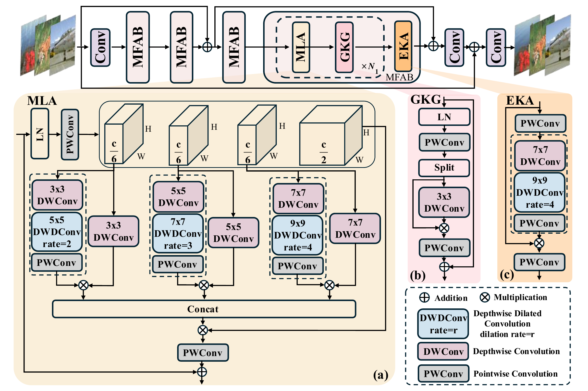
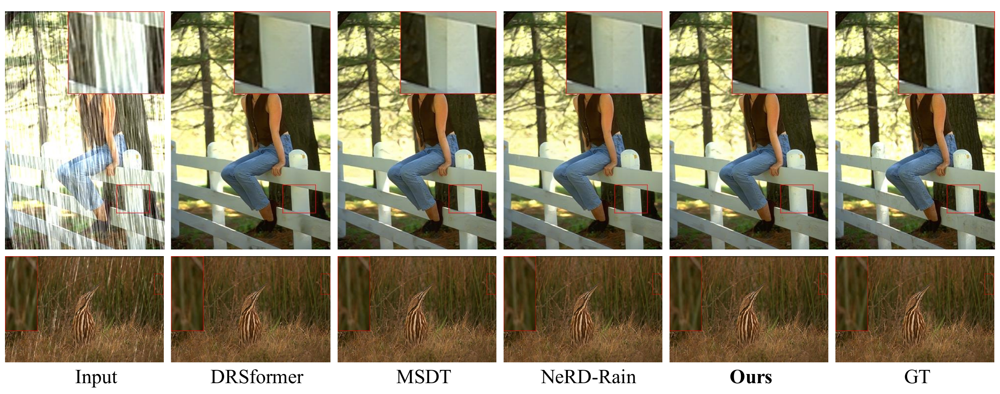
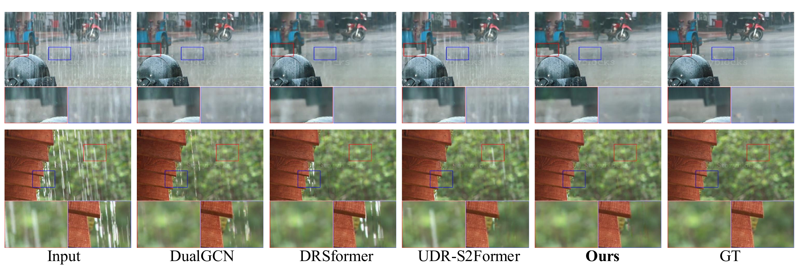

<div align="center">

# MSLKAD

### Multi-Scale Large Kernel Attention for Single-Image Deraining

**论文已被 IEEE ICIP 2026 录用**

Congcong Zeng · Dan Xu · Yinghui Zhu · Jiangang Pan · Kangjian He · Hongzhen Shi*

云南大学 · 信息学院

[论文 PDF](docs/paper/MSLKAD_ICIP2026.pdf) · [预训练权重](#预训练权重) · [快速使用](#快速使用) · [English](README.md)

</div>

**MSLKAD** 面向单幅图像去雨，通过多尺度大核注意力、局部特征门控与块尾上下文聚合，在统一的卷积特征空间中同时建模局部细节和长程依赖，应对空间分布不均匀的雨纹。

## 最新进展

- 论文已被 **IEEE ICIP 2026** 录用。
- 仓库已补充模型、训练与推理代码、模型结构图、去雨效果图与使用说明。

## 方法概览



网络包含 4 个多特征注意力块，每个块使用 9 对 MLA–GKG 模块，特征通道数为 180。

- **MLA：多尺度大核注意力。** 使用 3–5–1、5–7–1、7–9–1 三组卷积核，提取不同尺度的空间上下文。
- **GKG：Ghost 核门控。** 自适应选择局部特征，抑制雨纹并保留纹理。
- **EKA：扩展大核注意力。** 在每个块的末端聚合空间上下文。

[下载矢量结构图](assets/figures/architecture.pdf) · [实现与复现说明](docs/reproducibility.md)

## 视觉对比

### 合成雨图像



来自论文图 2；原图注将上下两行分别标为 Rain100H、Rain100L。**Ours** 为 MSLKAD，**GT** 为无雨真值。

### 真实雨图像



上行为 RealRain-1k-H，下行为 RealRain-1k-L。局部放大区域展示雨纹残留和纹理恢复情况。

## 预训练权重

| 数据集 | 类型 | 预训练权重 | 提取码 |
| :--- | :--- | :---: | :---: |
| Rain200L | 合成 | [百度网盘](https://pan.baidu.com/s/1CMVHZyQOieoO8Q4Go2e3Kw?pwd=ipnu) | `ipnu` |
| Rain200H | 合成 | [百度网盘](https://pan.baidu.com/s/1SvZTKXpIJimpUS5JKt390A?pwd=4xrj) | `4xrj` |
| SPA-Data | 真实 | [百度网盘](https://pan.baidu.com/s/1NY39HhT0n1HHU5Ynwjvh-w?pwd=ziym) | `ziym` |
| RealRain-1k-L | 真实 | [百度网盘](https://pan.baidu.com/s/1X1qFBNBD-zeB6VnVhBJ8pg?pwd=pb2p) | `pb2p` |
| RealRain-1k-H | 真实 | [百度网盘](https://pan.baidu.com/s/1yzy-tF6bXA1aAl1c6sIunQ?pwd=47gu) | `47gu` |
| LHP-Rain | 真实 | [百度网盘](https://pan.baidu.com/s/1roCSCPpqpha7B78qe2gUgw?pwd=gxuk) | `gxuk` |

权重沿用原仓库的下载链接。下载后放入 `pretrained/`，通过 `--weights` 指定文件。

## 快速使用

### 安装环境

```bash
git clone https://github.com/Easesgr/MSLKAD.git
cd MSLKAD
python -m venv .venv
source .venv/bin/activate
python -m pip install -r requirements.txt
```

GPU 训练或推理请安装与 CUDA 版本匹配的 PyTorch。原研究环境使用 Python 3.9、PyTorch 1.13.1、CUDA 11.7。本次代码检查环境见[发布验证](docs/reproducibility.md#release-validation)。

### 推理

```bash
# 对文件夹中的雨图像去雨
python test.py \
  --weights pretrained/Rain200H.pt \
  --input datasets/Rain200H/test/LR \
  --output outputs/Rain200H

# 使用 CPU 处理单张图像
python test.py \
  --weights pretrained/Rain200H.pt \
  --input path/to/rainy.png \
  --output outputs/single \
  --device cpu
```

推理结果以 PNG 格式保存在输出目录中；无需提供真值图像或 VGG19 权重。

## 训练

数据按照以下结构存放，`LR` 为雨图、`HR` 为无雨真值：

```text
datasets/Rain200H/
├── train/
│   ├── LR/001.png
│   └── HR/001.png
└── test/
    ├── LR/002.png
    └── HR/002.png
```

感知损失需要本地 **torchvision VGG19 ImageNet 预训练权重**（[官方下载](https://download.pytorch.org/models/vgg19-dcbb9e9d.pth)）。

```bash
# 单 GPU
python main.py \
  data.train_data_root=./datasets/Rain200H/train \
  data.val_data_root=./datasets/Rain200H/test \
  train.vgg_model_path=./pretrained/vgg19.pth \
  'train.gpus=[0]'

# 四 GPU：单进程 DataParallel
python main.py \
  data.train_data_root=./datasets/Rain200H/train \
  data.val_data_root=./datasets/Rain200H/test \
  train.vgg_model_path=./pretrained/vgg19.pth \
  'train.gpus=[0,1,2,3]'
```

默认训练 100K 次迭代，batch size 为 8，patch 为 128 × 128，使用 AdamW，学习率由 1e-4 余弦衰减至 1e-6。SPA-Data 使用 400K 次迭代：在 `main.py` 后追加 `configs/spa.yaml`，并设置对应的数据集路径。

```bash
# 恢复模型、优化器、学习率调度器与迭代步数
python main.py weights=./runs/RUN_NAME/latest.pt resume=true \
  data.train_data_root=./datasets/Rain200H/train \
  data.val_data_root=./datasets/Rain200H/test \
  train.vgg_model_path=./pretrained/vgg19.pth \
  'train.gpus=[0]'
```

日志与权重保存在 `runs/`。添加 `sys.cpu=true` 可进行 CPU 冒烟检查；完整训练建议使用 CUDA GPU。更多配置见 [`configs/default.yaml`](configs/default.yaml)。

## 引用

```bibtex
@inproceedings{zeng2026mslkad,
  title     = {Multi-Scale Large Kernel Attention for Single-Image Deraining},
  author    = {Zeng, Congcong and Xu, Dan and Zhu, Yinghui and Pan, Jiangang and He, Kangjian and Shi, Hongzhen},
  booktitle = {IEEE International Conference on Image Processing (ICIP)},
  year      = {2026},
  note      = {Accepted}
}
```

## 致谢与联系

感谢 [MAN](https://github.com/icandle/MAN) 和 [VAN](https://github.com/Visual-Attention-Network) 的组件实现，许可说明见[第三方声明](THIRD_PARTY_NOTICES.md)。

通讯作者：**Hongzhen Shi**，邮箱：[hongzhen.shi@ynu.edu.cn](mailto:hongzhen.shi@ynu.edu.cn)。代码问题请在 [Issues](https://github.com/Easesgr/MSLKAD/issues) 中反馈。
